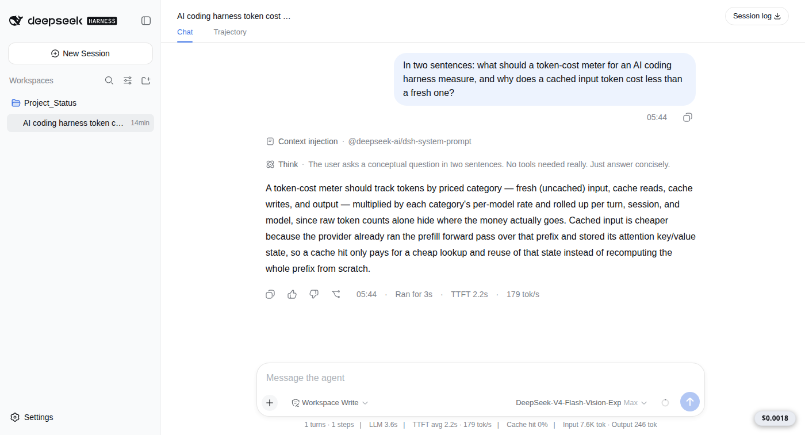
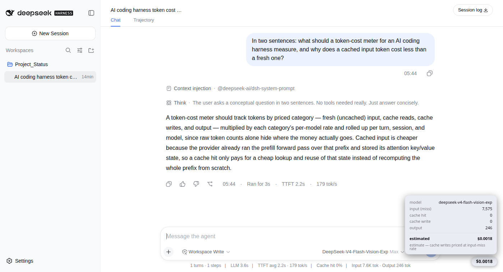

# dsh-cost-bubble

A draggable **$ pill** that floats in the DeepSeek Harness web shell and shows the **live estimated
cost of the current chat**. Click it to expand the breakdown.

Built for [DeepSeek Harness](https://github.com/deepseek-ai/deepseek-harness) `0.1.1-rc.2`.

<picture>
  <source media="(prefers-color-scheme: dark)" srcset="docs/pill-dark.png">
  
</picture>

Clicking it opens the breakdown — the billed token buckets, the resolved model, and the fee band:

<picture>
  <source media="(prefers-color-scheme: dark)" srcset="docs/panel-dark.png">
  
</picture>

Both are a real session, not a mock: one genuine one-shot agent run, which the pill priced at
**$0.0018** — 7,575 uncached input tokens and 246 output tokens at `deepseek-v4-flash` rates. The
shell's own footer independently reports the same totals (`Input 7.6K tok · Output 246 tok`).

## What it shows

- **$ total** for the session, updated every 3 s and on every turn end.
- Expanded: the real billed token buckets — input miss / cache hit / cache write / output —
  cache-hit %, input vs output cost, the **resolved model**, and whether the current rate band is
  **peak (2x)** or off-peak.
- Reads provider-reported `tokenUsage` totals from `sessionProjections`, **not** a `chars/4`
  estimate, so the numbers match what is billed. The model is read from the session log's
  `request/header` event, falling back to the agent default.
- Shows in **every** session, and survives restarts: it is a persistent dual-face profile plugin,
  not a dynamic one.

Costs are labelled an **estimate**: cache writes are priced at the input-miss rate, and the DeepSeek
V4 peak/off-peak schedule (peak 01:00-04:00 and 06:00-10:00 UTC, Mon-Fri = 2x) is embedded in the
host half.

## Layout

| Half | File | Does |
|---|---|---|
| Host | `lib/index.js` | Registers `GET /cost-bubble/usage?sessionId=...` via `webServer.register`; injects `["webServer","sessions","sessionProjections"]`; loopback + Host-header guard |
| Client | `lib/client.js` | Registers in the root `shell.overlay` slot; injects `["slots","timer"]`; polls every 3 s; drag via pointer capture; `--dsw-alias-*` theme variables |
| Manifest | `package.json` | `main` (host), `exports["./client"]`, `exports["./package.json"]`, `dsh.client.platform: "web"` |

`lib/` is committed deliberately — this plugin installs by **copying files**, not by running a
package manager inside a profile (see below), so the built output is the deliverable.

## Install

**Do not run `pnpm`/`npm` inside `~/.dsh/profiles/*`.** Doing so materialises a second copy of
`@deepseek-ai/dsh-*`; two copies means two `Symbol` instances and every tool call dies with
`Cannot read properties of undefined (reading 'prepare')`. See
[the split-Symbol write-up](https://github.com/samorachumbi/dsh-plugin-install-guide).

Copy the files and register the plugin through the profile's patch layer:

```bash
DEST=~/.dsh/profiles/web/node_modules/dsh-cost-bubble
mkdir -p "$DEST"
cp -r lib package.json "$DEST"/
```

```yaml
# ~/.dsh/profiles/web/cordis.patch.yml  (append)
- insert:
    - id: cost-bubble
      name: 'dsh-cost-bubble'
```

Then restart the server. Host-half changes need a restart; client-half changes need a hard refresh
(HMR is off in the web profile).

## Verify

```bash
# Host route live => {"ok":false,"error":"session-not-found"} rather than a 404
curl -s "http://127.0.0.1:3080/cost-bubble/usage?sessionId=x"

# Client half served => 200
curl -s -o /dev/null -w "%{http_code}\n" http://127.0.0.1:3080/plugins/dsh-cost-bubble/client.js
```

## Gotchas for third-party plugin authors

Each of these cost a crash or a silent failure while building this.

- **Typert remote services are a dead end for third-party plugins.** The client only mounts
  *compiled* descriptor contributions bundled into `dsh-api-remotes`, so `inject: ["remote.<name>"]`
  never resolves. Use a host HTTP route plus a client `fetch()` — the pattern used here.
- **Never return an explicit `undefined` field from a host route.** `cloneJson` rejects the whole
  reply (`result.model must be lossless JSON data`). Normalise to a primitive or `null`.
- **`exports` must include `"./package.json"`.** Without it `client-modules` fails
  `require.resolve("<pkg>/package.json")` and the client bundle silently 404s.
- **The client factory needs the CJS prologue** (`var module = { exports: {} }; var exports =
  module.exports; ...`). Without it the browser module system calls the factory as a plain function,
  `exports is not defined`, and the boot screen reports "Failed to load plugins".
- **Persistent plugins do not get the dynamic sandbox builtins** (`harness`, `host.call`, `React`,
  `styles`) — those exist only for `cordis_define` packages.

## Licence

MIT (c) 2026 Samora Chumbi. See `LICENSE`.

## Status

Working and in daily use on the author's machine since 2026-09-17. The screenshots above are
captured from a real session, not staged. The split-Symbol write-up link is the remaining item
before this repository is published.
